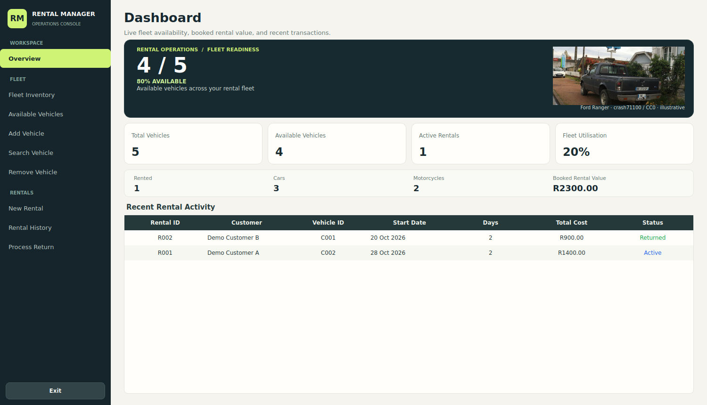
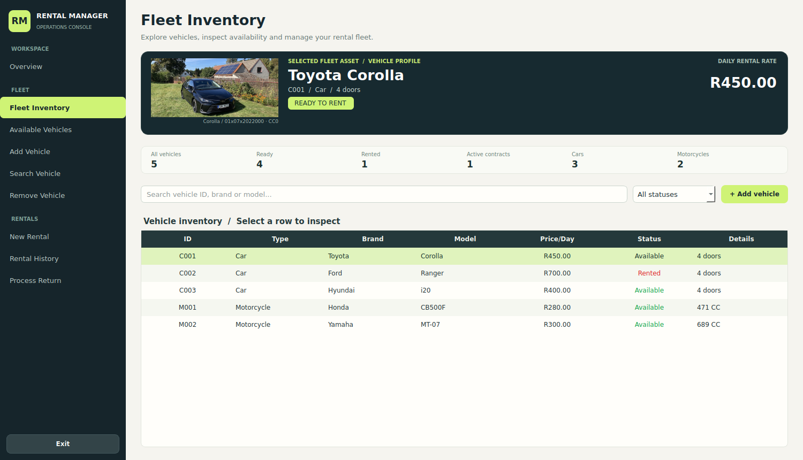
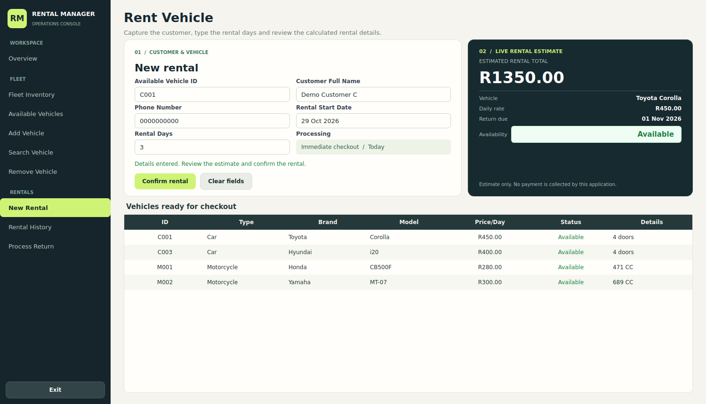
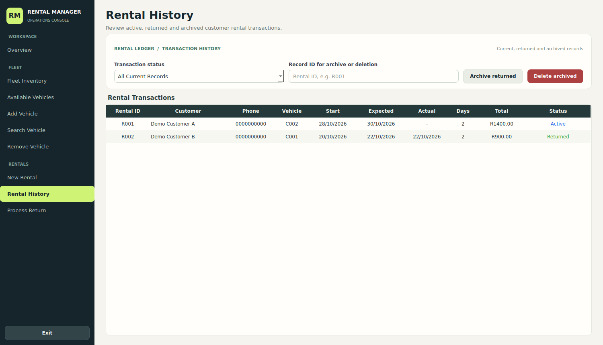
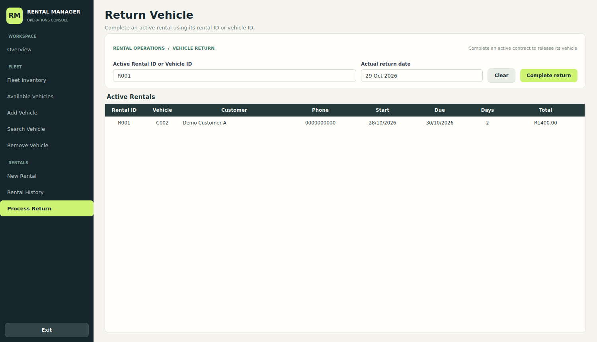

# Vehicle Rental Management System

**C++17 · Qt Widgets · CMake · CTest**

A desktop rental operations application built from a university C++/Qt project and being developed into a reliable, distinctive graduate software engineering portfolio demonstration. It manages a fictional small car and motorcycle fleet, rental checkout, returns and history using the existing C++ domain model.

> **Review status · 29 October 2026:** The Dashboard, Fleet Inventory, New Rental, Rental History and Return Processing have been redesigned in **real Qt Widgets** on [Draft PR #4](https://github.com/Sonkhe-Shongwe/vehicle-rental-system/pull/4). The latest acceptance code [`9f6dd7c`](https://github.com/Sonkhe-Shongwe/vehicle-rental-system/commit/9f6dd7c32b2f3feb14aa85a1f3c4c5329de19e50) passed hosted Linux and Windows compilation and both CTests, plus offscreen GUI screenshot checks. **Manual Windows Qt Creator interaction, physical display scaling, final photography, and owner visual approval are still pending.** PR #4 is not merged into stable `main`. This is **not** a production-certified rental service.

## Real Qt Widgets interface

These screenshots were captured from the compiled Qt executable with **fictional demo records** on the review branch, not from an HTML prototype. The vehicle photography is illustrative and does **not** depict actual owned rental fleet vehicles. The screenshots show visual-review candidates, not completed Windows physical-monitor acceptance.



| Fleet Inventory | New Rental |
| --- | --- |
|  |  |
| Rental History | Return Processing |
|  |  |

[1280×720 screenshots and visual audit](design/qt-spike/VISUAL_REVIEW.md) · [Photography source/licence register](assets/README.md) · [Windows manual acceptance checklist](docs/WINDOWS_ACCEPTANCE.md)

**Design direction:** Precision Atelier × Editorial Grand Touring. Graphite navigation, warm mineral surfaces, restrained lime actions, semantic status colours and representative automotive photography. Final image quality and aesthetic sign-off remain open.

## Working functionality

- Register, search, filter and remove cars or motorcycles with validation and generated identifiers.
- Check current availability and prevent double-booking.
- Create an immediate same-day rental for 1–365 days, with a live calculated total and expected return date. **A booking is not a collected payment.**
- Return vehicles with confirmation, reject repeated returns, archive only returned rentals and delete only archived records.
- Display live fleet metrics, active contracts and rental history.
- Reload persistent vehicles and rentals from the existing human-readable text format; an active rental determines occupancy after restart.

## Verification evidence

| Test environment | What was executed | Result |
| --- | --- | --- |
| [Ubuntu 24.04 / Qt6 / GCC](https://github.com/Sonkhe-Shongwe/vehicle-rental-system/actions/runs/40936435098) | CMake build, CTest domain and Qt GUI lifecycle, ten compiled-Qt screenshots | **2/2 tests passed; screenshots passed** |
| [Windows Server 2022 / MSVC2022 / Qt 6.8.3](https://github.com/Sonkhe-Shongwe/vehicle-rental-system/actions/runs/40936435292) | CMake Release, both CTests, 12 Qt offscreen and simulated-DPI captures, fixture integrity | **2/2 tests passed; screenshots passed** |

Both runs tested code revision `9f6dd7c`. GUI integration tests use isolated `QTemporaryDir` records and cover add, rent, double-book rejection, restart, return, archive, delete, keyboard events, status contrast and selected layout geometry at 1280×720 and 1500×860. **Offscreen CI is not real-screen or mouse/keyboard sign-off.**

## Build and test locally

Use a **Qt 6 desktop kit**, CMake 3.16+ and a C++17 compiler. Open `CMakeLists.txt` in Qt Creator, select a compatible desktop kit and build target `VehicleRentalSystem_A3`. The same build can be run from a terminal after configuring Qt for CMake:

```bash
cmake -S . -B build -DBUILD_TESTING=ON
cmake --build build --config Release
ctest --test-dir build -C Release --output-on-failure
```

On Windows, use the same kit/compiler/Qt environment for the CMake commands. The `CMAKE_PREFIX_PATH` option may be required outside Qt Creator to locate Qt. Qt 5 compatibility is not covered by the documented latest CI.

## Disposable demo data and privacy

`demo/vehicles.txt` and `demo/rentals.txt` contain **fictional records only**. The normal application still uses its legacy **source-adjacent** `vehicles.txt` / `rentals.txt` paths. For manual tests, first create a **new disposable clone**, confirm it has no real customer files and copy the demo fixtures into that clone's source directory. **Never overwrite actual operational files.**

The GUI regression tests inject a private temporary directory, so they do not modify normal application data. Runtime records are git-ignored. Photographs are locally bundled Qt resources and their credited licences are in [`assets/README.md`](assets/README.md).

## Engineering boundaries

C++17, Qt Widgets/Qt Core, inheritance and polymorphism, CMake, CTest, Qt containers and `QSaveFile` atomic per-file saving. On startup the rental ledger reconstructs vehicle occupancy, and opening the application does not rewrite files.

Known deferred engineering risks include source-adjacent writable storage, skipped malformed rows without clear diagnostics, ID reuse after deletion, non-integer currency storage, and lack of multi-file database transactions. SQLite, an API, a browser client, a standalone installer and cloud features are **not implemented**. None are being introduced before the Qt acceptance milestone is approved.

## Development and review

- [Authoritative current AI handoff](docs/AI_HANDOFF_CURRENT.md)
- [Reproducible tests and exact run evidence](docs/TESTING.md)
- [Current milestone and future roadmap](docs/ROADMAP.md)
- [Real Qt visual review](design/qt-spike/VISUAL_REVIEW.md) and [rental-screen review](design/qt-spike/RENTALS_REVIEW.md)
- [Windows Qt Creator acceptance procedure](docs/WINDOWS_ACCEPTANCE.md)
- [Architecture](docs/ARCHITECTURE.md), [security limitations](SECURITY.md), [development continuity](docs/CONTINUITY.md)
- [Draft PR #4](https://github.com/Sonkhe-Shongwe/vehicle-rental-system/pull/4) and [Issue #2](https://github.com/Sonkhe-Shongwe/vehicle-rental-system/issues/2)

**Release gate:** passing automated tests alone does not make this project approved or portfolio-ready. Manual Windows interaction, native 100/125/150% display scaling, final rights-compliant photo quality and explicit owner approval must still be documented before any merge.
