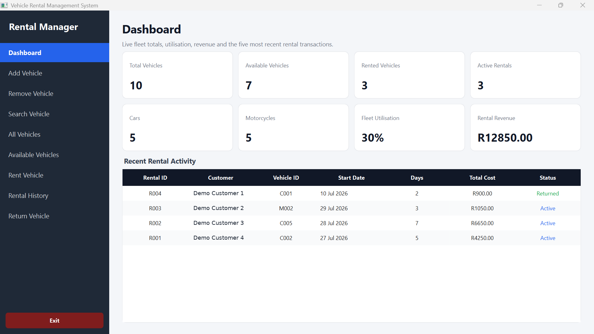
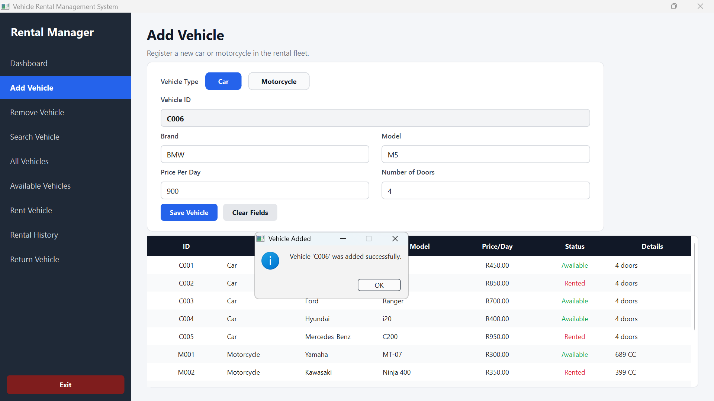
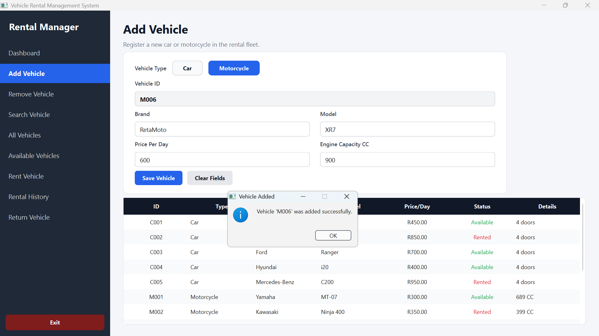

# Vehicle Rental Management System

A C++17 / Qt Widgets desktop application for managing a small car and motorcycle rental fleet. Originally developed as a university project and now undergoing a focused reliability, testing, and documentation upgrade for graduate software engineering applications.

> **Status (29 October 2026):** The complete sanitized C++/Qt source is committed. [GitHub Actions run 40872123623](https://github.com/Sonkhe-Shongwe/vehicle-rental-system/actions/runs/40872123623) **passed** on Ubuntu 24.04 with Qt 6 (fixture hygiene, CMake configuration, compilation, CTest). An interactive **Windows Qt Creator GUI test is still pending**. This is not a production-certified rental service.

> **Current AI/developer handoff:** [Start here: latest implementation branch, test evidence and next acceptance steps](docs/AI_HANDOFF_CURRENT.md). The redesigned Qt UI lives in **unmerged Draft PR #4**, not on stable `main`; Windows GUI acceptance is still pending. Older design/roadmap notes are chronological, not the current source of truth.

> **Continuation prompt for another AI:** [Copy the verified GitHub development prompt](docs/AI_CONTINUATION_PROMPT.md).\n\n## Core features

- Add, search and remove cars or motorcycles, with sequential IDs and input validation.
- Create rental transactions, check availability and prevent double bookings.
- Calculate the rental amount, rental duration and expected return date.
- Process returns by rental or vehicle ID; archive and delete completed records.
- Display fleet totals, active rentals, utilisation, recent transactions and historical totals.
- Persist fleet records and rental transactions using a human-readable legacy text format.

## Screenshots

These are historical screenshots from the original Qt student build, **not evidence that the current hardened build has passed runtime testing**. Only vehicle-only screens without customer records are included.





## Technology

C++17, Qt Widgets / Qt Core, CMake, Qt containers, object-oriented domain models, file I/O and CTest.

## Build and test

Requires a Qt 6 (recommended) or compatible Qt 5 installation with a CMake-discoverable desktop kit, CMake 3.16+, and a C++17 compiler.

```bash
cmake -S . -B build -DCMAKE_PREFIX_PATH="/path/to/Qt" -DBUILD_TESTING=ON
cmake --build build --config Release
ctest --test-dir build --output-on-failure -C Release
```

When using Qt Creator, open `CMakeLists.txt`, choose the Qt Desktop kit, configure, build and run the `VehicleRentalSystem_A3` target. To run tests, select `vehicle_rental_tests` or invoke CTest in the build directory.

**For Windows:** use a Qt kit configured in Qt Creator; Qt Creator normally sets the CMake prefix automatically. The application opens maximised for the wide rental tables.

## Safe demo data

The files under [`demo/`](demo/) contain fictional customer labels and placeholder phone numbers. The live `vehicles.txt` and `rentals.txt` files are ignored by Git because rental records contain personal information.

For a clean disposable demonstration, copy `demo/vehicles.txt` and `demo/rentals.txt` into the **project source directory**, then run the app from Qt Creator. **Do not overwrite existing real customer data.** The current legacy default stores runtime files beside source code; the planned application-data migration is tracked in the roadmap.

```text
Vehicle: Type|ID|Brand|Model|PricePerDay|IsRented|ExtraValue
Rental:  Rental|RentalID|Customer|Phone|VehicleID|StartDate|ExpectedReturnDate|ActualReturnDate|Days|PricePerDay|TotalCost|Returned|Archived
```

## Engineering notes

- Rental history is the authoritative occupancy ledger; on startup vehicle rented flags are reconstructed from active rentals.
- Individual file writes use `QSaveFile` and return failure rather than silently reporting success. This is **not** a full multi-file transactional database.
- Startup no longer rewrites files as a side effect of loading.
- Domain checks reject invalid pricing, totals and record separators in new transactions.
- Domain regression tests use isolated temporary storage and do not modify a developer's source fixtures.
- Known risks remain: source-adjacent writable files, skipped malformed rows without user warnings, ID reuse after deletion, no database migration, no customer authentication, and no completed runtime verification.

## Documentation

- [V2 aesthetic direction comparison: three unapproved design concepts](design/v2/COMPARISON.md) (not Qt screenshots)
- [Aesthetic-only V2 research: visual identity, three art directions, and design acceptance](docs/VISUAL_AESTHETICS_RESEARCH_V2_2026-10-29.md) (**research only; no Qt changes**)
- [Phase 1: Operator Console visual prototype and design specification](design/README.md) (proposal only, not Qt implementation)
- [Full comparative portfolio and UX research (29 October 2026)](docs/PORTFOLIO_RESEARCH_2026-10-29.md)
- [Architecture](docs/ARCHITECTURE.md)
- [Source audit](docs/AUDIT.md)
- [Deadline-focused engineering roadmap](docs/ROADMAP.md)
- [Reproducible testing checklist](docs/TESTING.md)
- [Next-session continuity handoff](docs/CONTINUITY.md)
- [Security and privacy limitations](SECURITY.md)

## Scope and honesty

This is a Qt desktop application, **not** a React web application, REST API or full-stack cloud product. The next natural extension after reliable core functionality is a transaction-backed SQLite data layer and optional service/API boundary. The emphasis for this portfolio milestone is clean domain logic, careful defect handling, automated tests, reproducibility and documentation.
