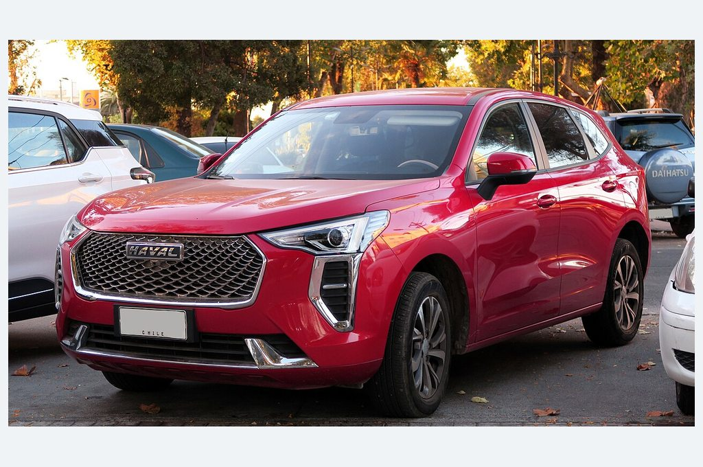
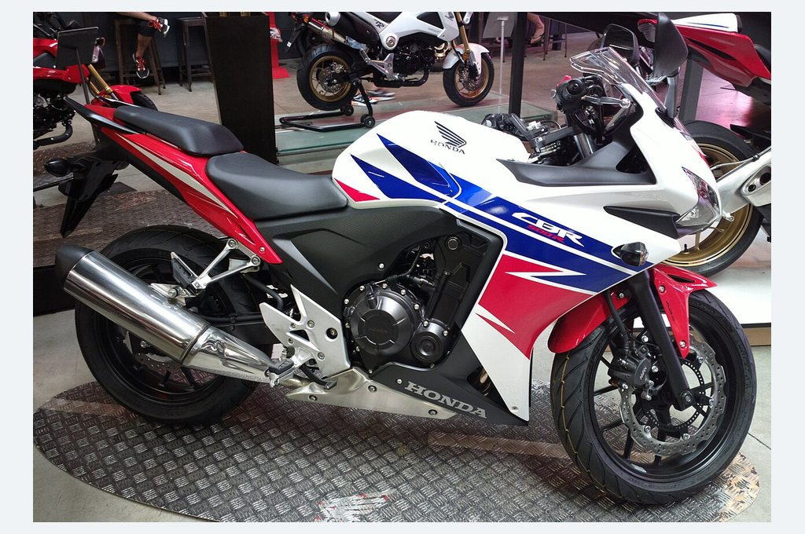
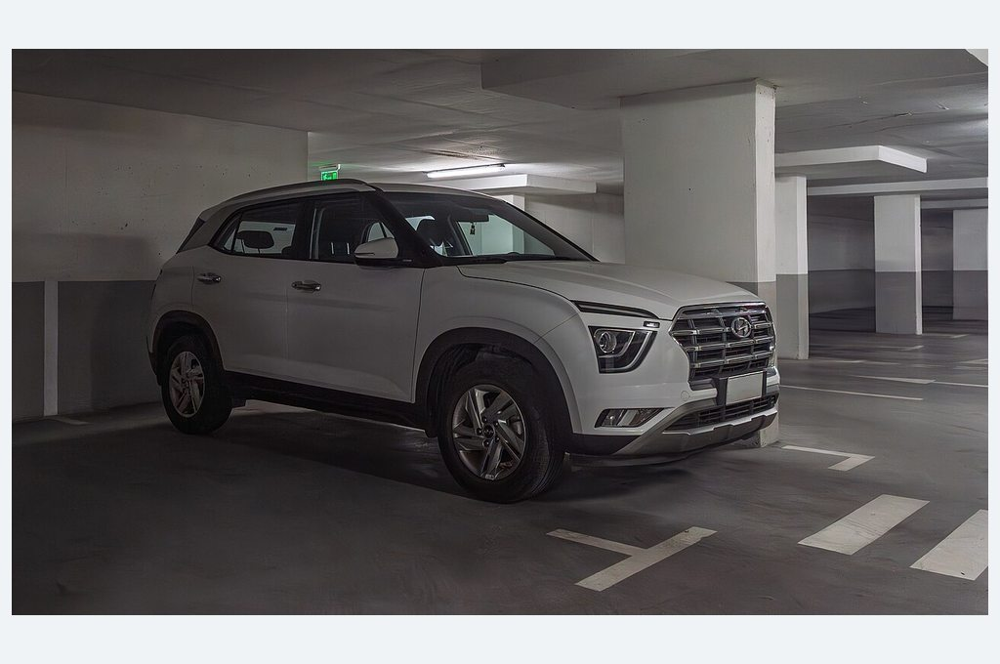
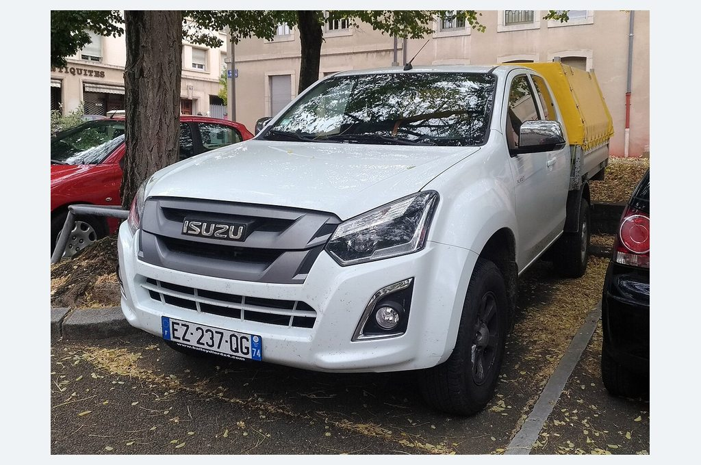
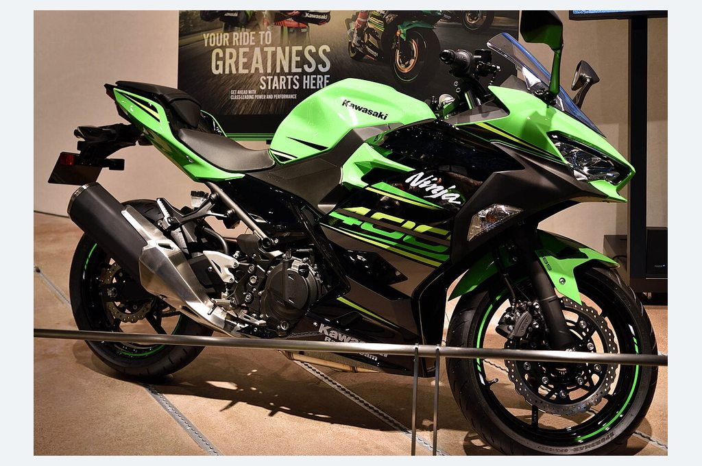
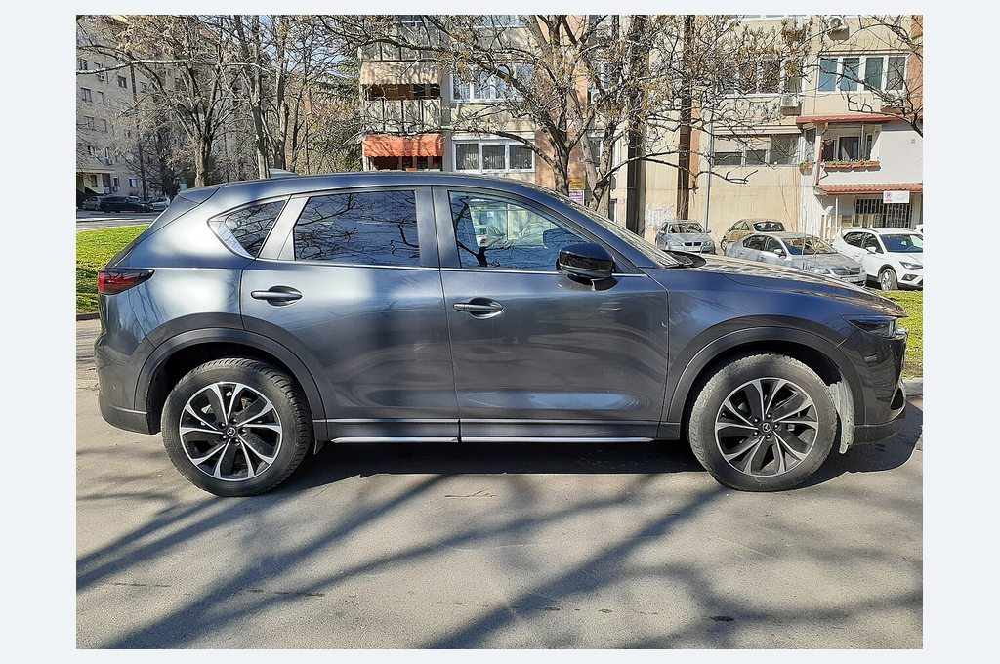
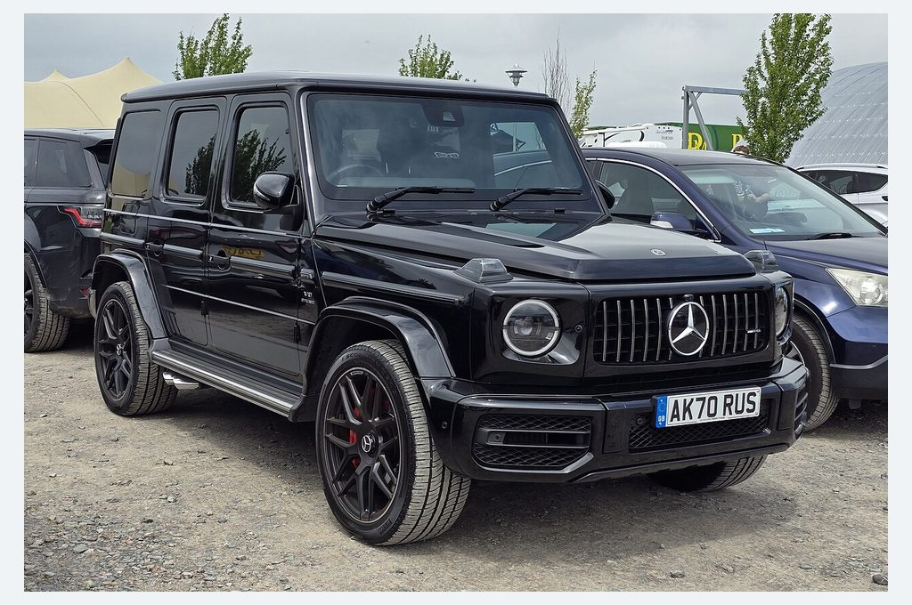
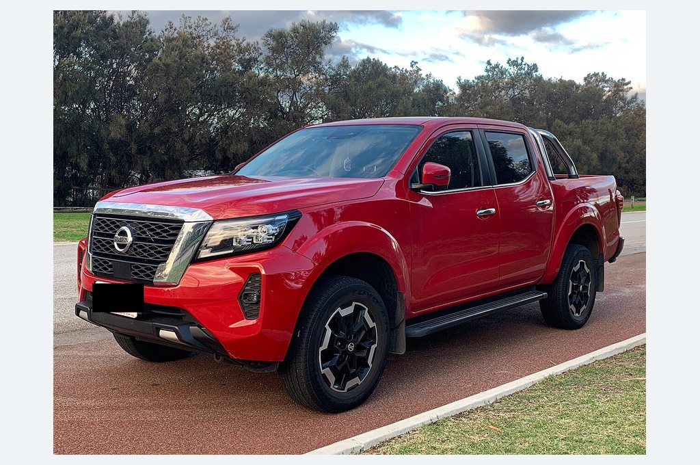
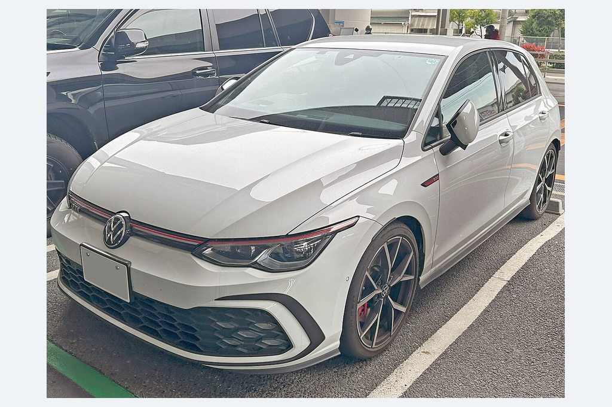
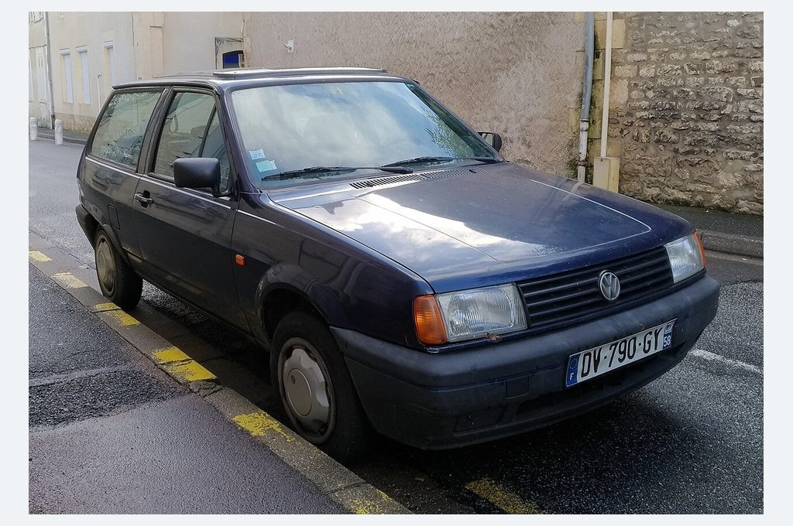

# Batch 01 | Ten acquired model-specific vehicle photographs

**R0 portfolio research, staged only.** These ten source images are downloaded, converted to 1024 × 680 local JPEGs, and credited. They are NOT yet used by the Fleet UI. **Visual approval remains open**. Click an image to inspect its source.

| Vehicle image | Vehicle image |
|---|---|
| **Haval Jolion**  
  
[Commons photo](https://commons.wikimedia.org/wiki/File:Haval_Jolion_1.5T_Active_2022.jpg) · [CC BY-SA 2.0](https://creativecommons.org/licenses/by-sa/2.0) | **Honda CBR500R**  
  
[Commons photo](https://commons.wikimedia.org/wiki/File:Honda_CBR500R.jpg) · [CC BY-SA 3.0](https://creativecommons.org/licenses/by-sa/3.0) |
| **Hyundai Creta**  
  
[Commons photo](https://commons.wikimedia.org/wiki/File:Hyundai_Creta_A740048.jpg) · [CC BY-SA 4.0](https://creativecommons.org/licenses/by-sa/4.0) | **Isuzu D-Max**  
  
[Commons photo](https://commons.wikimedia.org/wiki/File:Isuzu_D-Max_(45114138465).jpg) · [CC0](http://creativecommons.org/publicdomain/zero/1.0/deed.en) |
| **Kawasaki Ninja 400**  
  
[Commons photo](https://commons.wikimedia.org/wiki/File:Kawasaki_Ninja_400.jpg) · [CC BY-SA 4.0](https://creativecommons.org/licenses/by-sa/4.0) | **Mazda CX-5**  
  
[Commons photo](https://commons.wikimedia.org/wiki/File:Mazda-CX-5.jpg) · [CC BY-SA 4.0](https://creativecommons.org/licenses/by-sa/4.0) |
| **Mercedes-Benz G-Class**  
  
[Commons photo](https://commons.wikimedia.org/wiki/File:2020_Mercedes_G_63_AMG_4Matic_Auto.jpg) · [CC BY-SA 4.0](https://creativecommons.org/licenses/by-sa/4.0) | **Nissan Navara**  
  
[Commons photo](https://commons.wikimedia.org/wiki/File:2021_Nissan_Navara_facelift.jpg) · [CC BY-SA 4.0](https://creativecommons.org/licenses/by-sa/4.0) |
| **Volkswagen Golf GTI**  
  
[Commons photo](https://commons.wikimedia.org/wiki/File:Volkswagen_GOLF_GTI_(7BA-CDDNP)_front.jpg) · [CC0](http://creativecommons.org/publicdomain/zero/1.0/deed.en) | **Volkswagen Polo**  
  
[Commons photo](https://commons.wikimedia.org/wiki/File:VW_Polo_(32865914808).jpg) · [CC0](http://creativecommons.org/publicdomain/zero/1.0/deed.en) |

## Visual review checklist

- [ ] Make/model recognisable for each image
- [ ] No inappropriate crop, legibility issue or misleading object
- [ ] Suitable visual balance across cards
- [ ] Owner approves photo selection before changing Qt map

**Provenance:** [Image credits](IMAGE_CREDITS.md), [full acquired manifest](source_manifest.json). The SHA256 hashes and photographer/licence URLs are stored per file.

