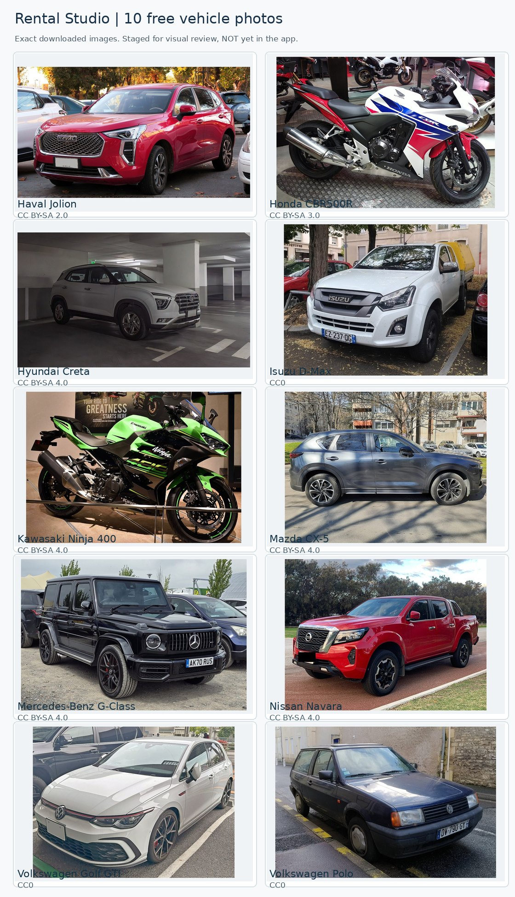

# Batch 01 | Actual acquired vehicle photographs

**Ten model-matched candidates downloaded for free and stored locally.** These are the exact staged JPEG files, not stock search previews. They are not yet displayed in Rental Studio. Review their visual quality before an integration change.

## Single-sheet preview

## Inspect individual files and licence sources

| Vehicle | Vehicle |
|---|---|
|  <strong>Haval Jolion</strong> <a href="https://commons.wikimedia.org/wiki/File:Haval_Jolion_1.5T_Active_2022.jpg">Original source</a> · <a href="https://creativecommons.org/licenses/by-sa/2.0">CC BY-SA 2.0</a> |  <strong>Honda CBR500R</strong> <a href="https://commons.wikimedia.org/wiki/File:Honda_CBR500R.jpg">Original source</a> · <a href="https://creativecommons.org/licenses/by-sa/3.0">CC BY-SA 3.0</a> |
|  <strong>Hyundai Creta</strong> <a href="https://commons.wikimedia.org/wiki/File:Hyundai_Creta_A740048.jpg">Original source</a> · <a href="https://creativecommons.org/licenses/by-sa/4.0">CC BY-SA 4.0</a> |  <strong>Isuzu D-Max</strong> <a href="https://commons.wikimedia.org/wiki/File:Isuzu_D-Max_(45114138465).jpg">Original source</a> · <a href="http://creativecommons.org/publicdomain/zero/1.0/deed.en">CC0</a> |
|  <strong>Kawasaki Ninja 400</strong> <a href="https://commons.wikimedia.org/wiki/File:Kawasaki_Ninja_400.jpg">Original source</a> · <a href="https://creativecommons.org/licenses/by-sa/4.0">CC BY-SA 4.0</a> |  <strong>Mazda CX-5</strong> <a href="https://commons.wikimedia.org/wiki/File:Mazda-CX-5.jpg">Original source</a> · <a href="https://creativecommons.org/licenses/by-sa/4.0">CC BY-SA 4.0</a> |
|  <strong>Mercedes-Benz G-Class</strong> <a href="https://commons.wikimedia.org/wiki/File:2020_Mercedes_G_63_AMG_4Matic_Auto.jpg">Original source</a> · <a href="https://creativecommons.org/licenses/by-sa/4.0">CC BY-SA 4.0</a> |  <strong>Nissan Navara</strong> <a href="https://commons.wikimedia.org/wiki/File:2021_Nissan_Navara_facelift.jpg">Original source</a> · <a href="https://creativecommons.org/licenses/by-sa/4.0">CC BY-SA 4.0</a> |
|  <strong>Volkswagen Golf GTI</strong> <a href="https://commons.wikimedia.org/wiki/File:Volkswagen_GOLF_GTI_(7BA-CDDNP)_front.jpg">Original source</a> · <a href="http://creativecommons.org/publicdomain/zero/1.0/deed.en">CC0</a> |  <strong>Volkswagen Polo</strong> <a href="https://commons.wikimedia.org/wiki/File:VW_Polo_(32865914808).jpg">Original source</a> · <a href="http://creativecommons.org/publicdomain/zero/1.0/deed.en">CC0</a> |

### Review gates

- [ ] Recognisable make and model in every image
- [ ] Clear composition and suitable card framing
- [ ] No distracting or badly cropped vehicle
- [ ] Owner approves before image mapping in the application changes

For source credits and file hashes see [IMAGE_CREDITS.md](IMAGE_CREDITS.md) and [source_manifest.json](source_manifest.json).

