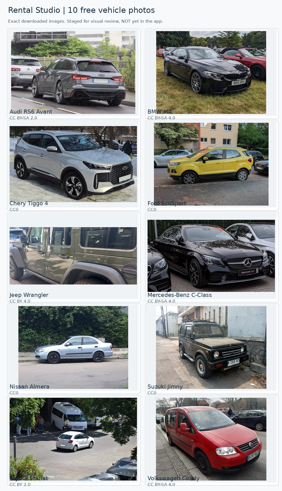

# Batch 02 | Ten downloaded candidate vehicle photos

**Portfolio image staging only.** The contact sheet below is generated from downloaded, SHA256-checked source photos. It is not the live Fleet gallery.

## Models

Suzuki Jimny, Chery Tiggo 4, Jeep Wrangler, Volkswagen Caddy, Nissan Almera, Toyota Starlet, Mercedes-Benz C-Class, Ford EcoSport, BMW M4 and Audi RS6 Avant.

**Human visual approval:** open after acquisition and check that each image actually depicts the named make/model, has a pleasant viewing angle and is usable in a vehicle card. Model year, colour and trim need not be exact.

The specific photographer, free Creative Commons licence, canonical original file page, modification and output SHA256 are in [image credits](IMAGE_CREDITS.md) and [manifest](source_manifest.json).

Batch 01's ten downloaded photos stay unchanged. These files are staged separately from the compiled application; **no Qt photo mapping is altered**.
