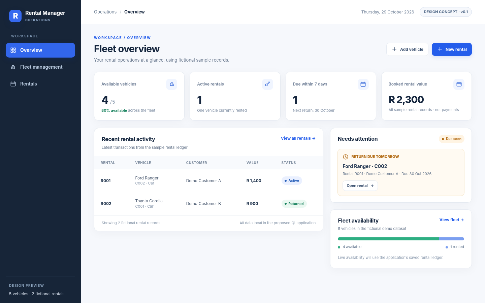
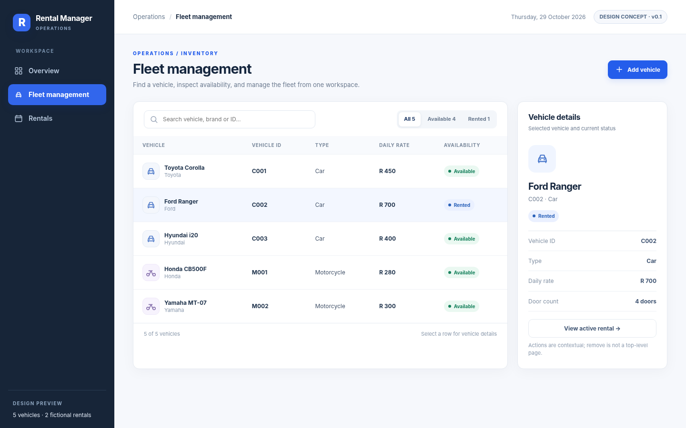
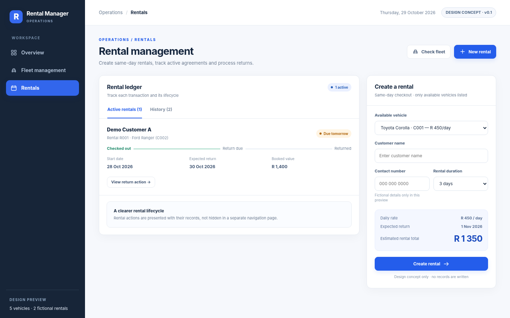

# Operator Console — visual design proposal v0.1

**Status:** Design prototype only. These are **not** screenshots of the compiled C++/Qt application and are **not** evidence of a completed GUI redesign.

This package proposes an operator-focused navigation and visual language for the existing `vehicle-rental-system` Qt Widgets desktop application. It preserves the rental domain and is based on the repository's fictional demo data as of 29 October 2026.

- [Complete design and interaction specification](DESIGN_SPEC.md)
- [Interactive, self-contained HTML concept](prototype.html) (open locally to navigate; no file writes or backend)
- [Dashboard screen concept](dashboard.png)
- [Fleet management concept](fleet.png)
- [Rental management concept](rentals.png)
- [Dashboard layout at 1280 px](dashboard-1280.png)

## What this means for implementation

Approved current constraints: **C++17 / Qt Widgets**, preserve working rental/return and data-loading behaviour, keep personal records private. Proposed (not yet approved): reduce permanent navigation, redesign dashboard hierarchy, introduce Fleet and Rentals workspaces, centralise styling. API, SQLite and advance-booking features remain future milestones.

**Next:** Review the three layouts for desirability and operational correctness, agree any changes, then implement a bounded Qt milestone with CI/domain and Windows GUI acceptance tests.

## V2 aesthetic comparison (29 October 2026)

The user requested a more visually distinctive visual identity after reviewing V1. Three **unapproved** browser-rendered aesthetic directions are available in [design/v2](v2/COMPARISON.md): **A Precision Atelier**, **B Nocturne Instrument**, and **C Editorial Grand Touring**. [Visual comparison HTML](v2/visual_comparison.html), full-resolution renders, and same-data review notes are preserved. These are design-only artifacts, **not C++/Qt implementation**.
